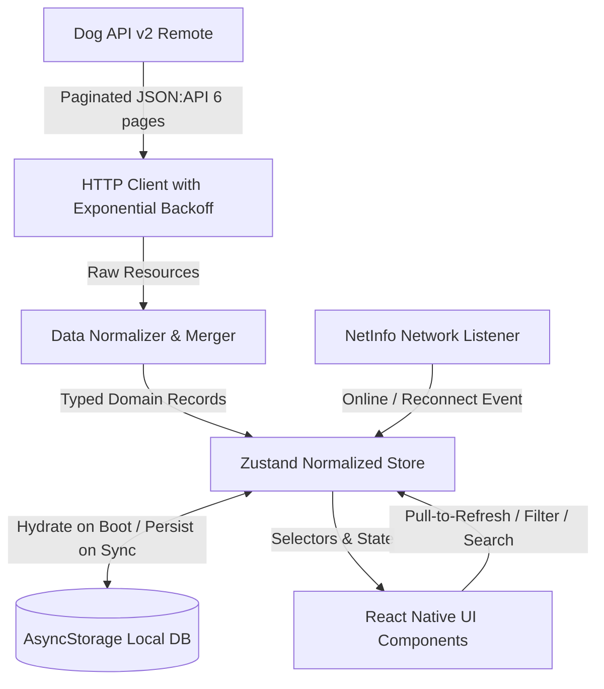
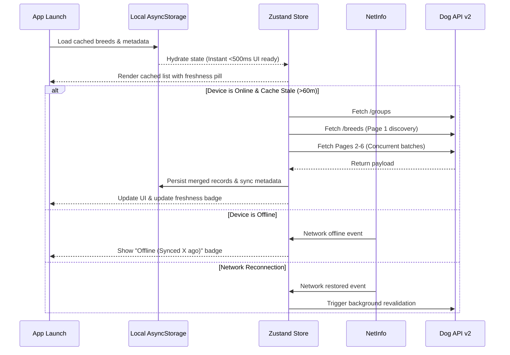
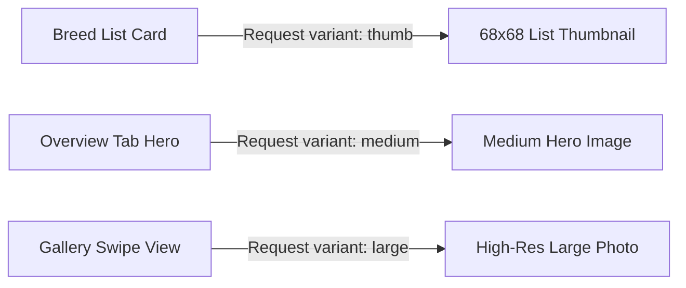

# Architecture Overview

Dog Breed Explorer is engineered with an offline-first, reactive architecture designed to handle unreliable network conditions, large JSON:API payloads, and smooth 60fps list interactions.

---

## High-Level Architecture & Data Flow

The application follows a unidirectional data flow pattern:

### Three-Tier Layering

1. **API & Network Layer (`src/api/`):**
   - Resilient `fetchWithRetry` client implementing exponential backoff with randomized jitter to prevent thundering herd issues.
   - Intelligent paginator fetching 6 API pages (48 items/page) using controlled concurrency batches (batch size = 2) to prevent socket exhaustion on mobile devices.
   - Partial failure isolation: if pages 1-4 succeed but page 5 encounters an error, the data pipeline preserves retrieved records, merges with existing cache, and surfaces a non-intrusive warning banner.

2. **Persistence & Cache Layer (`src/db/`):**
   - Normalized local cache storing records across versioned key namespaces:
     - `@dog_breeds:v1:breeds`: Normalized key-value map of domain `Breed` objects.
     - `@dog_breeds:v1:groups`: Breed group metadata and member IDs.
     - `@dog_breeds:v1:sync_meta`: Last sync timestamp, record count, and partial sync status.
     - `@dog_breeds:v1:image_cache_meta`: Registry tracking cached image URLs, variants (`thumb` / `medium` / `large`), and access timestamps for LRU pruning.
   - Instant startup hydration: on app launch, local storage is read first before network checks, allowing the interface to become interactive in under 500ms.

3. **State Management & UI Layer (`src/store/`, `src/screens/`, `src/components/`):**
   - Global Zustand store holding normalized state (`breedsById`, `breedIds`, `groupsById`, `groupIds`).
   - Derived memoized selectors for multi-criteria filtering (search query, breed group, size bands, coat length, hypoallergenic toggle, and 3 trait minimum thresholds).
   - Component tree wrapped in `ErrorBoundary` boundaries around major navigation and detail tabs to isolate view errors.

---

## Offline Synchronization Strategy

### Key Offline Features

- **App Works Fully Offline:** Once the 283 breeds are fetched or restored from local storage, users have complete access to search, all filter dimensions, section grouping, and detail tabs without network access.
- **Background Sync:** The `useNetworkSync` hook monitors connectivity. When a device recovers from an airplane-mode or dropped connection state, the store evaluates cache TTL (60 minutes) and automatically initiates a background sync if stale or if the previous sync was partial.
- **Data Freshness Indicator:** Real-time relative duration formatting ("Just now", "15 minutes ago", "Yesterday") clearly displays how fresh the local database is.
- **Partial Failure Handling:** Rather than discarding existing data on network timeouts, partial results are merged into the normalized map and an actionable banner provides retry and dismiss controls.

---

## Image Caching Architecture

Dog API includes up to 9 photographs per breed with 3 resolution variants: `thumb`, `medium`, and `large`, alongside copyright and licensing attribution.

- **List Performance:** The 283-row virtualized list renders strictly `thumb` variants (~30-50KB each). This prevents high memory allocation and maintains smooth 60fps scrolling.
- **Detail View:** Loads `medium` for the overview card and escalates to `large` inside the swipeable gallery.
- **LRU Cache Registry:** Monitored through `recordCachedImage` to keep track of stored image references and prune entries when exceeding 100 images.
- **Attribution Preservation:** Each image object retains its author, license type, license link, and source repository information, surfaced cleanly in the Gallery tab.
